# 6 Adaboost models for wind power prediction, multi-variable input single step forecasting

Up to this period, a total of five articles on machine learning prediction family kits have been published. In this family kit, we add a universal Adaboost prediction model within this family. 
Why is it called a universal model? This algorithm can be integrated with any base learner, following the philosophy of "three cobblers are better than one clever man," by integrating the learning results of base learners to enhance the final model's prediction or classification capabilities. 
The Adaboost (Adaptive Boosting) algorithm, also known as the Adaptive Boosting algorithm, is an important ensemble learning algorithm in the field of machine learning, mainly applied to classification or prediction problems). The Adaboost algorithm utilizes the traditional Boosting idea, allowing a large number of weak classifiers to be combined in some way, ultimately obtaining a strong classifier/predictor with significantly improved classification/prediction capabilities. Its core idea is to train a series of weak classifiers by changing the weights of incorrectly labeled samples in the training set, and then connect these classifiers together. As the algorithm iterates, the centroid of the base classifier/predictor tends towards samples that are difficult to correctly classify/predict, achieving this goal by assigning different weights to each sample. Regarding the concept of the Adaboost algorithm, the author found a very good article in this literature review, which everyone can refer to. 
Wu Junli, Zhang Buhan, Wang Kui. Application of Improved BP Neural Network Based on ELM-Adaboost in Short-Term Wind Speed Prediction [J]. Power Grid Technology, 2012, 36(9):5. DOI:CNKI:SUN:DWJS.0.2012-09-036. 
The Adaboost model added in this period is as follows: 
ELM-Adaboost, RVM-Adaboost, SVM-Adaboost, BiLSTM-Adaboost, CNN-BiLSTM-Adaboost, RF Adaboost
As mentioned in previous articles, such as BiGRU, BiLSTM, GRU, LSTM, LSSVM, TCN, CNN, CNN-BiGRU, CNN-LSTM, etc., are all compatible with Adaboost.
Currently, the entire family set includes the following models:
The quantity is so vast, it's absolutely thrilling!
Reference article:
A plethora of machine learning predictions? Can't you just get it all done in one go?
Machine learning prediction of a family set, multi-step prediction of BiGRU, BiLSTM, GRU, LSTM, LSSVM, TCN, CNN, photovoltaic power generation data as an example.
Machine learning prediction of the family set, multi-step prediction model, and a combination prediction model for example in photovoltaic power generation data.
Machine Learning Prediction of the Family Pack - XGBoost, for example, traffic flow data prediction, MATLAB code
Machine Learning Prediction of the Family Kit - CNN-RVM (Relevance Vector Machine), Wind Power Forecasting, MATLAB Code
The code acquisition method is placed at the end of this text!
The above are just a few of the more commonly used ones. If you guys need anything in the future, just leave a message in the backend and I will continue to update this family pack!
Promise to keep this family pack permanently updated!
Data Preparation
The dataset is uniformly based on wind power generation data from a certain location in Xinjiang.
The data includes the following features: wind speed at 10m (m/s), wind speed at 30m (m/s), wind speed at 50m (m/s), wind speed at 70m (m/s), hub height wind speed (m/s), wind direction at 10m (°), wind direction at 30m (°), wind direction at 50m (°), wind direction at 70m (°), wind direction at hub height (°), temperature (°C), pressure (hPa), humidity (%) and actual power generation (mw). Some of the data is shown in the following screenshots:
Select March data, each sample composed of: delay step length is 10, cross time step length is 1. That is to say, using all the features of the first 10 samples to predict the power generation of the next sample.
As an example, take the data from January 1, 2019, 0:00 to 2:00 (including power) and combine them into one row. Then add the data at 2:15 to this row, forming the first sample. The last column is the power at 2:15. Continue in this way to generate many more samples. After that, divide the training set and test set is all good.

Results Display
ELM-Adaboost
BiLSTM-Adaboost:
CNN-BiLSTM-Adaboost:
RF-Adaboost:
SVM-Adaboost:
All the images and codes above can be achieved!
Machine Learning Prediction Full Kit Code
The ELM-Adaboost, RVM-Adaboost, SVM-Adaboost, BiLSTM-Adaboost, CNN-BiLSTM-Adaboost have been added to the Machine Learning Prediction Full Kit. The complete code can be obtained by clicking the link below:

## Images

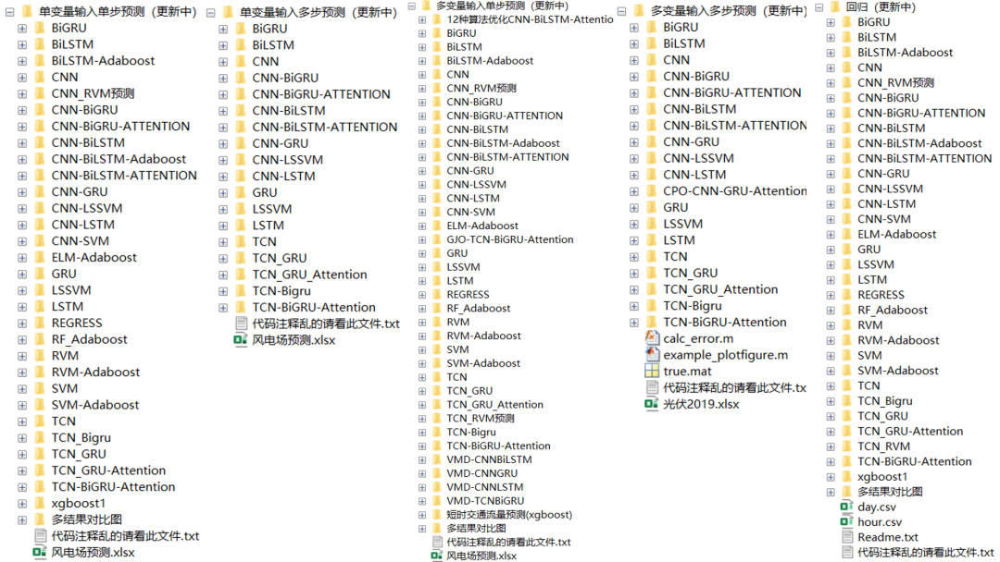
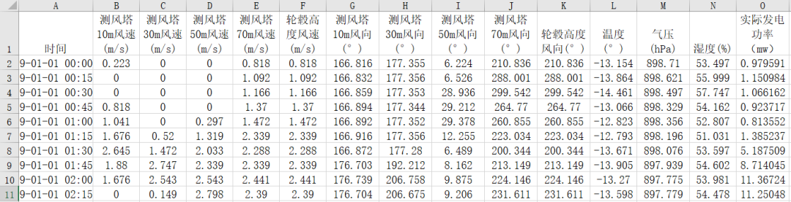
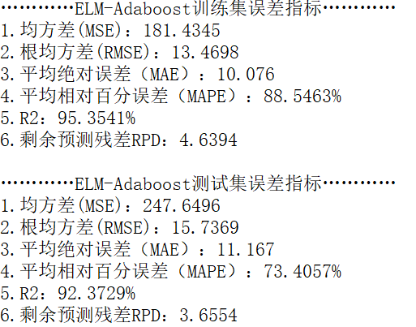
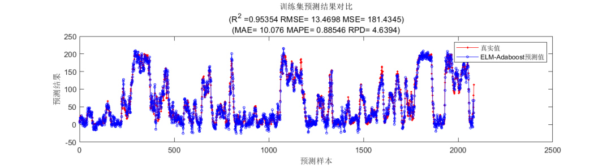

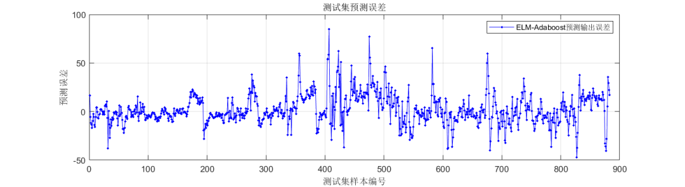
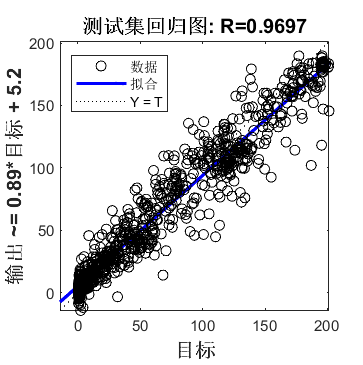
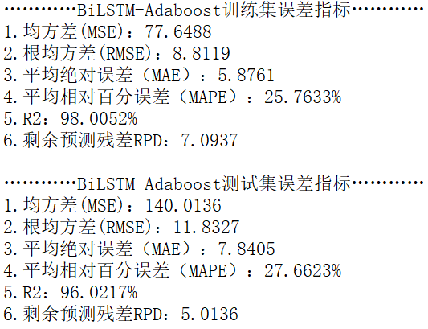

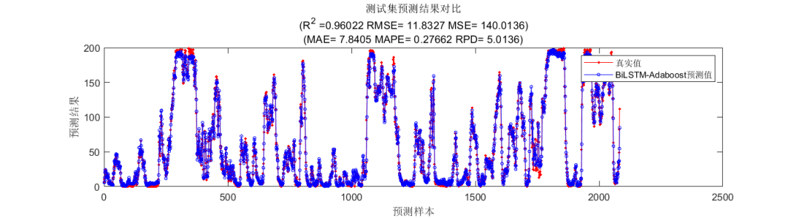
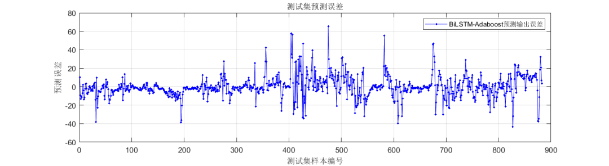
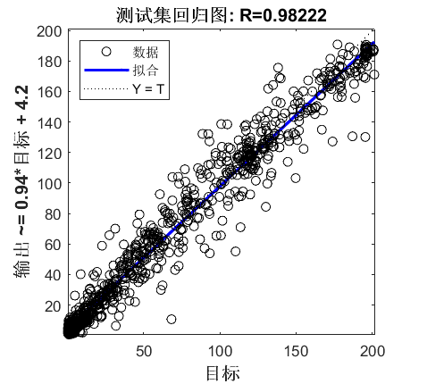
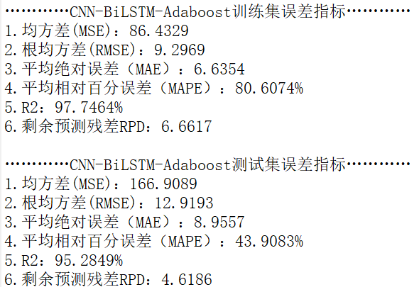
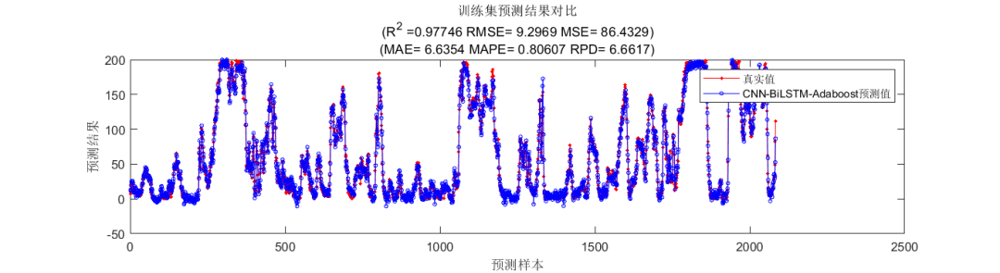

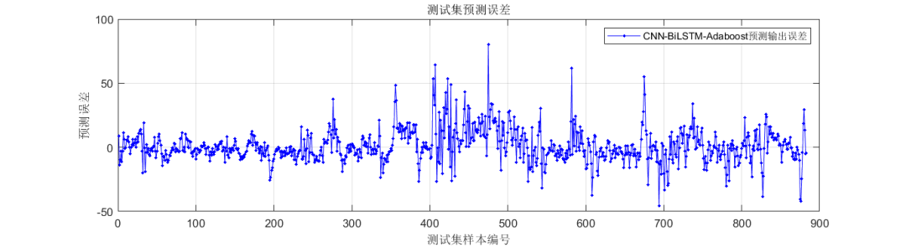
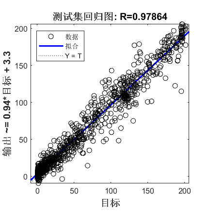
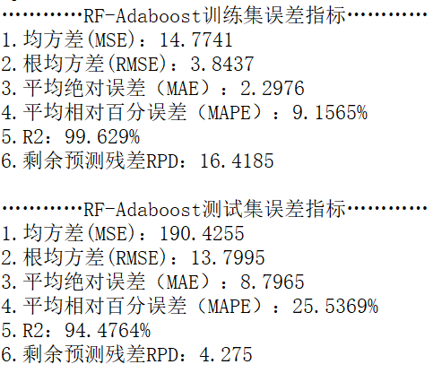
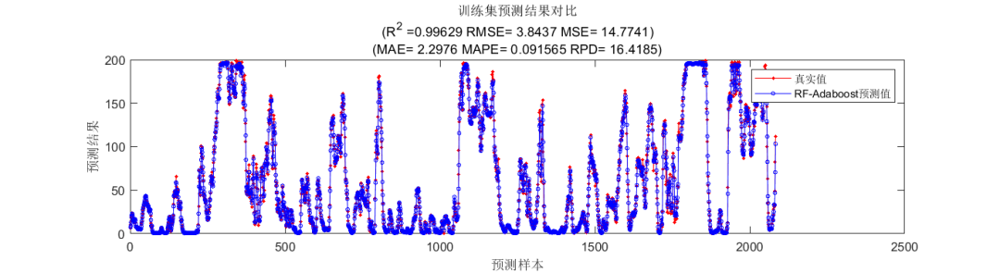

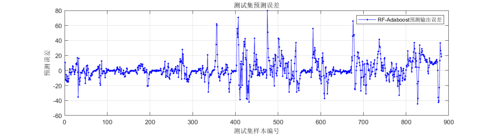
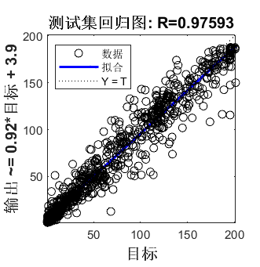
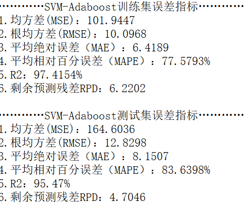
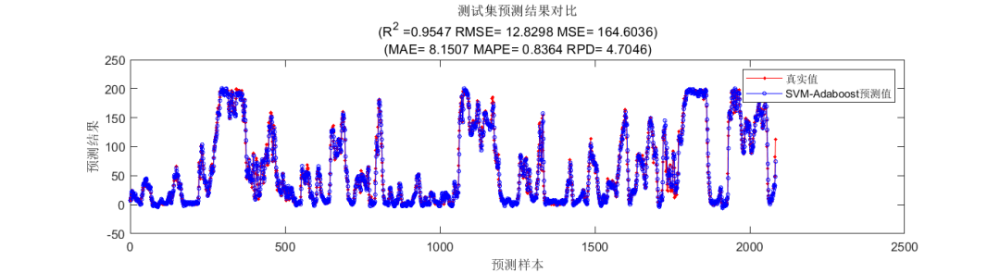

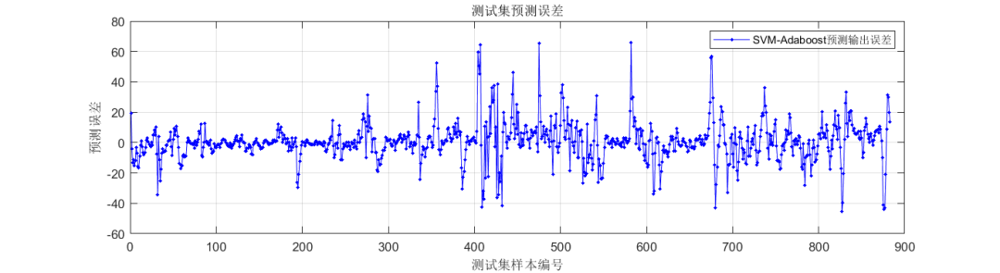
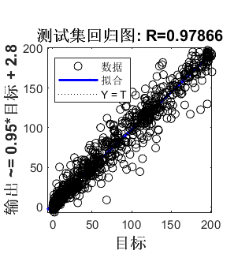

<!-- PAYMENT_BLOCK -->

## Get this dataset

- Payment link (Stripe): [Buy now](https://buy.stripe.com/3cs8yP7sY87d0vu9AB)
- Payment QR code: 

<!-- /PAYMENT_BLOCK -->
